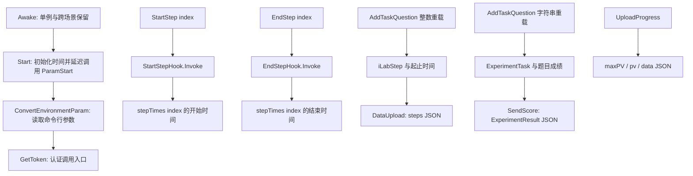

# 骨牵引护理原程序静态分析

2026-11-17，Mac 静态分析与既有 Windows 证据对应。当前对象为已下载的原版本地 Windows 游戏 `HLF10631030.exe.mengoo`、同目录 `UnityPlayer.dll` 和 `HLF10631030_Data/`。

项目资源约束已写入 `source/AGENTS.md`：程序运行和编译的实际内存均不超过 **2 GB**，各自包含子进程；编译进程树 CPU 总占用不超过**单个核心的 80%**。这些是后续立项、实现和编译的执行要求，当前成果为静态分析。

## 1. 工程与文件来源

工作目录：`/Volumes/Lexar/Project/医院仿真`。Windows交接分支已将Git根目录上移至此，原工程文件保留在 `source/`；两个Skill移至根目录 `.agents/skills/`，项目MCP配置移至根目录 `.codex/`。

| 对象 | 实际结果 |
|---|---|
| Git 仓库 | 项目根目录，原工程在 `source/`；远端 `https://github.com/sxyq/-unity.git` |
| 分支与提交 | `main`，`cb1ce4a964ce39330df1f378a468efb0d4f64dfb`；克隆时远端最新默认分支恰为附件中的参考提交 |
| 历史与附属文件 | 完整 Git 历史；`is-shallow-repository=false`；无子模块声明和 Git LFS 指针 |
| 官方 MSI | `reverse/input/MLauncherSetup.msi`，82,271,744 bytes |
| MSI SHA256 | `9153e7086ceceebc274a1a5e861af59ec5e90a9a527879c46c57bd5b06abbab9`，与用户 Windows 参考一致 |
| MSI 格式 | OLE Compound Document / MSI；Advanced Installer 15.7，Mengoo；内嵌 `disk1.cab`，MSZip，128 个文件 |
| 实验版本清单 | `reverse/input/experiment-Version.json`，版本 `1.0.7`，198 条，合计 415,271,836 bytes |
| 实验资源来源 | `https://skeletaltraction.cqmu.edu.cn/mzl/HLF10631030/1.0.7/Version.json` 及其 `fileList.fullName` 指向的同目录公开文件；请求无需认证信息 |
| 实验资源保留范围 | 下载清单 198 项后，删除 `StreamingAssets/access_token.txt`、`StreamingAssets/espLogin.json` 两项认证相关文件，内容未打开；保留 196 项 |
| 原始命名 | 实验文件保留 `.mengoo` 后缀；MSI 文件按其 File/Component/Directory 表恢复安装路径，内容保持原样 |
| 原游戏 EXE | `reverse/experiment/raw/HLF10631030.exe.mengoo`，653,824 bytes，PE32+ x86_64 |
| 原游戏 EXE SHA256 | `d15d807a405d12a0a2ec2150ea08b932da90a04780788ea7a9f695c46e36a047` |

厂商文件位于 `source/` Git 工作树之外。全部记录见 `analysis/file-inventory.tsv`；它列出保留文件的路径、大小、SHA256、格式、架构、程序集版本、PE 证书表及 Strong Name（程序集强名称签名区域）是否存在。非 PE 文件的架构与程序集版本为空。签名列记录结构是否存在；证书信任链有效性不在本轮范围。

文件清单共 324 项：启动器 128 项，122,052,939 bytes；实验保留 196 项，415,270,090 bytes。REA 对其中全部 244 个 PE/CLI 文件完成身份读取：启动器 89 个，实验 155 个，程序集版本均已取得。

| 实验核心文件 | SHA256 |
|---|---|
| `Assembly-CSharp.dll` | `4dcb5b0232c45885f087a6ada3cea52f315ff7dcef9eecdc9851f40d8842b825` |
| `Assembly-CSharp-firstpass.dll` | `09702aa630d65972352f1c1dc0e9c424b0ef630129467d305d62b62194233c89` |
| `MengooPlatform.dll` | `a17b52ef46e5bacd9ade2c01842094feb1fbe3580abc7c186b2e0dc544ba0311` |
| `data.unity3d` | `8781d14a06ccba7f42ad1cd5780863cc0654742aa3274462c1b8765177725277` |

下载中的一次 TLS 失败发生于 `UnityEngine.RuntimeInitializeOnLoadManagerInitializerModule.dll`；当时 `data.unity3d` 已下载完成。后续从剩余文件继续，URL 含空格的资源使用百分号编码。

## 2. 实际目录

```text
医院仿真/
├── source/                                  Git 工程
│   ├── .agents/skills/reverse-engineer-anything/
│   ├── .agents/skills/craft-anything/
│   ├── .codex/config.toml                    项目 MCP 配置
│   ├── docs/                                既有 Windows 证据
│   ├── tools/unity-observer/
│   ├── client-agent/agent.mjs
│   └── apps/extension/src/data/case-data.js
└── reverse/
    ├── input/
    │   ├── MLauncherSetup.msi
    │   └── experiment-Version.json
    ├── extracted/launcher/                  MSI 的 128 个文件
    │   ├── MCLocalLauncher.exe
    │   ├── UnityPlayer.dll
    │   ├── Version.json
    │   ├── Service/MCLocalLauncherService.exe
    │   ├── MCLocalLauncher_Data/
    │   │   ├── Managed/Assembly-CSharp.dll
    │   │   ├── globalgamemanagers、level0、*.assets
    │   │   ├── Resources/
    │   │   └── StreamingAssets/data.unity3d
    │   └── MonoBleedingEdge/{EmbedRuntime,etc/mono}/
    ├── experiment/raw/                      实验 1.0.7 的 196 个保留文件
    │   ├── HLF10631030.exe.mengoo
    │   ├── UnityPlayer.dll
    │   ├── HLF10631030_Data/
    │   │   ├── data.unity3d
    │   │   ├── Managed/{Assembly-CSharp.dll,Assembly-CSharp-firstpass.dll,MengooPlatform.dll,…}
    │   │   ├── Resources/unity default resources
    │   │   ├── RuntimeInitializeOnLoads.json
    │   │   ├── ScriptingAssemblies.json
    │   │   └── StreamingAssets/Video/{handel,introduce,xzsjmxs}.mp4
    │   └── MonoBleedingEdge/{EmbedRuntime,etc/mono}/
    ├── analysis/                            原始工具结果与文件清单
    └── 静态分析交付.md
```

`analysis/file-tree.txt` 为逐文件目录，`analysis/msi-file-layout.tsv` 保存 CAB 内文件 ID 到真实安装路径的对应关系。早期 REA/Craft 结果保留分析发生时的 CAB 平铺路径；通过该对应表可定位现有文件，例如 `AssemblyCSharp.dll` 对应 `MCLocalLauncher_Data/Managed/Assembly-CSharp.dll`。

`Patch.json` 未出现在 MSI 的 128 项和实验清单的 198 项中；请求实验版本目录下该文件返回 HTTP 404。启动器代码含 `GetPatchFile`，具体生成路径和运行时语义尚未取得本轮证据。

## 3. 项目级工具配置

| 项目 | 实际状态 |
|---|---|
| REA | 复用本机官方 `rea-agents` 6.9.0；Node 22.23.5 满足当前官方 `^22.23.4` 要求 |
| 默认 Node/npm | 默认 Node 24.21.0、npm 10.9.2；REA 配置显式使用符合要求的 22.23.5 |
| REA Skill | 官方仓库 `.agents/skills/reverse-engineer-anything`，版本 62；安装于 `source/.agents/skills/` |
| Craft Anything | 复用本机官方 CLI 0.6.1；Skill 来自上游 `crates/setup/src/skill.md`，版本 2，同样安装于项目目录 |
| MCP | 两项均写入 `source/.codex/config.toml`；实际启动这两个命令完成 `initialize`、`tools/list` 和会话读取，分别返回 255 / 323 个工具 |
| 本轮使用方式 | 静态分析通过官方 CLI 执行；独立 MCP 连接用于确认配置命令可运行；真实 schema 保存在 `analysis/*-tool-schemas.json` |
| doctor | 结果保存在 `analysis/rea-doctor.json`；Node 可用；可选原生反汇编引擎缺失，内置 .NET 静态分析可用 |
| Codex 项目加载 | 已在用户配置中仅登记 `source/` 的项目信任；新启动的 app-server 通过 `config/read` 返回两个项目 MCP，项目层已启用。Skill 与 MCP 注册均留在项目目录 |
| 当前会话执行 | 直接读取项目 Skill，通过现有官方 CLI 执行分析；项目 MCP 命令也已完成独立连接。用户已明确继续使用当前会话，无需重启 |

两套 setup 的预览均默认指向用户全局配置，因此采用官方手工 stdio 配置方式，将服务器注册限定到项目。独立 MCP 结果保存在 `analysis/mcp-session.json`。

REA 的 `--evidence-bundle` 在外置文件系统写入失败，错误响应已携带完整 `partial_observation`；已直接保留该次成功分析的完整 Evidence JSON。后续分析使用标准输出保存 JSON。

## 4. 已取得的静态程序集结果

类型计数包含工具列出的 `<Module>` 元数据项。

| 文件与角色 | REA 结果 | 类型 / 字段 / 方法 |
|---|---|---|
| 原游戏 `HLF10631030.exe.mengoo` | x64 原生 PE；CLI 目录为零；导入 `UnityPlayer.dll!UnityMain` | 不适用 |
| 启动器 `MCLocalLauncher.exe` | x86 原生 PE，CLI 数据目录不存在；托管成员不可取得 | 不适用 |
| 启动器 `Assembly-CSharp.dll` | PE/CLI，Unity Mono，AnyCPU，程序集版本 0.0.0.0 | 85 / 1,073 / 417 |
| 启动器 `Service/MCLocalLauncherService.exe` | 正常 PE/CLI；WebSocket 接收与启动服务 | 7 / 23 / 21 |
| 实验 `MengooPlatform.dll` | PE/CLI，AnyCPU，版本 0.0.0.0 | 29 / 193 / 171 |
| 实验 `EngineHttp.dll` | 正常 PE/CLI；UnityWebRequest 请求封装 | 20 / 45 / 80 |
| 实验 `ESPPost.dll` | 正常 PE/CLI；事件、患者状态与上传支持类 | 45 / 237 / 322 |
| 实验 `QFramework.Log.dll` | 正常 PE/CLI；日志枚举及输出 | 3 / 8 / 12 |
| 实验 `Assembly-CSharp.dll` | `target_unavailable / unsupported_target / unsupported binary format` | 无法从磁盘格式取得 |
| 实验 `Assembly-CSharp-firstpass.dll` | 同上 | 无法从磁盘格式取得 |

`MengooPlatform.dll` 的 155 个方法含 CIL（.NET 中间指令）方法体，解码覆盖完整，取得 815 个调用位置、627 个字段访问位置。Craft Anything 同时取得 29 个属性、0 个 C# event 声明。REA 的 native-boundaries 结果为 0 个 P/Invoke、16 个 runtime 实现方法；这些 runtime 方法包含委托构造及 Invoke 等声明。

启动器程序集另有 42 个 P/Invoke 声明、8 个 ModuleRef，集中在 Windows 窗口、进程及系统接口。`MCLocalLauncher.exe` 与实验 `UnityPlayer.dll` 的 PE 内嵌 Authenticode 证书表均为空。

### 平台核心模型

| 类型 | 静态确认的字段或属性 |
|---|---|
| `MengooCx` | `uploadData: ExperimentResult`、`iLabSteps: List<iLabStep>`、`stepTimes`、`pass`、`hookOverride`、`totalScore`；属性 `progressData`、`hasProgress`、`Instance` |
| `ExperimentResult` | `ProgressId, CourseId, ExperimentId, Tag, Total, Score, TimerLong, ExperimentTaskList` |
| `ExperimentTask` | `No: int, Name: string, ExperimentTaskQuestionList: List<ExperimentTaskQuestion>` |
| `ExperimentTaskQuestion` | `No: int, Content: string, Total: int, Score: int, IsRight: bool` |
| `iLabStep` | `seq, title, startTime, endTime, timeUsed, expectTime, maxScore, score, repeatCount, evaluation, scoringModel, remarks, done` |
| 委托字段 | `StartStepHook/EndStepHook: Action<int>`；`AddTaskQuestionHook: Action<int,string,int,int,int,int,string,string,string,int,int>`；`DataUploadHook: Action<int,string,string,string,string>` |

### 方法与调用关系



图中初始化为方法职责关系；平台步骤的调用方和实际任务触发仍位于加密业务程序集。以下行为有 CIL 支持：

- `StartStep(int index)`：若存在钩子则调用；`hookOverride=true` 时返回，否则创建或取得 `stepTimes[index]` 两项数组，将 UTC Unix 毫秒写入 `[0]`。
- `EndStep(int index)`：同样处理钩子，再写入 `[1]`；缺少对应开始记录时输出 `index:{0},没有调用StartStep`。
- 两个钩子的 `Invoke` 静态调用位于 `MengooCx.StartStep/EndStep` 本身，均在 CIL 偏移 `0x0f` 调用 MemberRef `0x0a00003c`。已将结果合并到 `source/docs/Unity本地状态输出.md` 第 4.1 节；业务代码如何调用 StartStep/EndStep 仍待原有运行时导出定位。
- `AddTaskQuestion(string taskName, string questionContent, int total, int score, bool isRight)`：按任务与题目查找，创建缺失项或更新题目 `Total/Score/IsRight`。
- `AddTaskQuestion(int seq, string title, int expectTime, int maxScore, int score, int repeatCount, string evaluation, string scoringModel, string remarks, int done, int timeIndex)`：按序号查找 `iLabStep`，从计时表取得时间，新增或更新步骤结果。
- `SendScore(int total,int score)`：填充并序列化 `ExperimentResult`，通过协程 `SaveExperimentResult` 提交。
- `DataUpload(int score,string title,string objName,string successName,string failName)`：将 `iLabSteps` 序列化为 `steps`，同时生成 `username/title/status/score/startTime/endTime/timeUsed/originId` 字段。
- `UploadProgress(int maxP,int currentP,string data)`：封装 `maxPV/pv/data`，进入 `IUploadProgress`。

静态端点：`/api/Course/SaveExperimentResult`、`/api/open/dataupload`、`/api/open/ProcessUpload`。本轮只读取这些常量与调用指令。

启动器可读业务入口：`Updater.CheckUpdaterVersion/GetNeedUpdateVersions/OnLoadVersionFileCallBack/GetPatchFile/StartDownload/StartGame`，`SelfUpdater.CompareVersion/GetPatchFile`，`GMWebResourceLoadManager.DownloadFileAsyncWC`，`GMWinApi.StartProcess`。它们负责版本、下载和启动，不含护理实验任务的完整业务实现。

### 原游戏 EXE 的实际入口

以下地址为磁盘映像首选基址下的静态地址。EXE 的 PE32+ 可选头起于文件偏移 `0x130`，其中 `AddressOfEntryPoint` 为 `0x1260`，`ImageBase` 为 `0x140000000`；CLI 数据目录为 `0/0`。


原始指令位于 `analysis/rea/HLF10631030.entry.asm`：入口先调用 `0x1400014c4`，随后跳入上述路径；跳板使用 RIP 相对间接跳转访问导入地址表（IAT）。该调用点向 `rcx` 传入 EXE 基址、向 `rdx` 传入零、向 `r8/r9` 传入前两次内部调用的结果。导入表与导出表将两端明确连接；内部包装函数的 C 运行库名称尚未解析。

依据：REA 导入 Evidence `ev_084ab77ecedb5544ffb77ed085eeccd5ba42841c268d38e6efd943d06bbbf97d`；UnityPlayer 导出 Evidence `ev_8dd1003c595896b6f40cb62896ade80dfaa09c0e08acbe4f1e56ddb24bda4c2e`。`objdump -f` 的摘要输出 start address 为零，实际入口采用上述 PE 字段。

继续读取 `UnityMain` 指令可见：`0x180690936` 调用内部地址 `0x18068dcc0`，随后经两次导入表间接调用处理返回值。原始导出段保存于 `analysis/rea/experiment-UnityPlayer.UnityMain.asm`。

引擎文件名引用已定位如下。地址、指针值和指令均从本版本 DLL 直接读取；这些位置用于后续追踪，完整装载函数职责仍待解析。

| 文件名 | 字符串地址 | 指针及代码位置 |
|---|---|---|
| `data.unity3d` | `0x1816eb438` | 全局指针 `0x181a0dc90`；`0x1804a260d/0x1804a2fba` 读取该指针 |
| `ScriptingAssemblies.json` | `0x1817020a8` | 全局指针 `0x181a1a0e0`；`0x180b75146/0x180b751f0` 读取该指针 |
| `RuntimeInitializeOnLoads.json` | `0x18179ac10` | `0x180b74f1a` 取得字符串地址 |
| `mono_jit_init_version` | `0x181702a00` | `0x1806214d5` 取得名称，`0x1806214df` 调用名称解析候选函数 `0x1805651c0`，返回地址写入 `0x181ab5bc8`；解析函数职责为推断 |

数据路径和初始化代码段分别保存于 `experiment-UnityPlayer.data-path.asm`、`experiment-UnityPlayer.initialization.asm`。本次文件名范围检索在整份 DLL 的 UTF-8/UTF-16LE 中未找到 `.mengoo` 字样，扩展名处理位置尚未定位。

继续沿两个路径引用点取得以下原生调用，职责由参数流与错误字符串推导：

| 调用点 → 目标 | 指令与参数依据 |
|---|---|
| `0x1804a2668/0x1804a3026 → 0x180545a20` | 目录与 `data.unity3d` 两个指针/长度对象，分隔字符 `R8B=0x2f`，输出字符串由 `R9` 指定，构造 `<目录>/data.unity3d` |
| `0x1804a269a → 0x18053ff00` | 传入上述路径，返回布尔值；结合调用上下文推断为存在性探查 |
| `0x1804a3035 → 0x18054d470` | 管理对象、原目录和完整路径三个参数进入归档装载路径 |
| `0x18054d685 → 0x1805569d0` | 管理对象 `+0x10` 成员、完整路径字符指针、零值参数；失败分支引用 `Failed to install Player data archive: %s!` |
| `0x1805501fd → 0x18054ea40` | 经 `0x180556add→0x180555de7→0x180558c00→0x180559b60` 到达；流对象、长度 64、栈缓冲、实际读取量指针、第五参零值 |
| `0x18054ea74` | 通过流后端虚表 `+0x10` 分派读取；具体后端尚未解析 |

读取后代码逐字节访问缓冲直到零字节；实际取得的头内容、自定义格式转换位置与运行目录值仍未知。窄范围指令保存在 `experiment-UnityPlayer.data-path.asm` 和 `experiment-UnityPlayer.archive-read.asm`。

REA 与 Craft 另取得 EXE 的 12 项 Windows 资源：9 幅图标、1 个图标组、1 项版本、1 项 manifest。版本字符串 `Unity Version=2021.3.6f1_7da38d85baf6`；`FileVersion/ProductVersion=2021.3.6.8233869`。资源目录本次覆盖完整，未出现模型或护理任务条目。Evidence：REA `ev_14c804c8ea260fe838c124c2934a95294863a33ff4ec84960025f7863119e2fa`，Craft `ev_a221cfd3882fa6f8849ee7f512ae0dac42900eb16d44ccd099a38af55a76e1b6`。

### 步骤与题目写入的精确行为

下表由既有 REA/Craft 的完整 CIL 导出定位，所有 token 均限定于本版本 `MengooPlatform.dll`。

| 方法 token | CIL 位置 | 静态确认的行为 |
|---|---|---|
| `StartStep` `0x06000024` / `EndStep` `0x06000025` | 两者 `IL_000f` 调用 `Action<int>.Invoke`；`IL_0015` 读取 `hookOverride` | 钩子存在且正常返回后，`hookOverride=true` 提前返回；没有钩子或钩子抛出后，继续平台计时路径 |
| `StartStep` | `IL_003f` 查询键；`IL_0053` 新增两项数组；`IL_008b` 写 `[0]` | `stepTimes: Dictionary<int,long[]>` 保存开始/结束的 Unix 毫秒；重复开始覆盖已有开始值 |
| `EndStep` | `IL_006c` 写 `[1]`；`IL_0070` 起为错误处理 | 无对应开始记录时输出 `index:{0},没有调用StartStep` |
| 字符串 `AddTaskQuestion` `0x06000023` | `IL_0007` 按任务查找；`IL_005a` 按题目查找；`IL_0022/00e9` 为 Count+1 | `ExperimentResult.IndexOf` 比较 `Name`，`ExperimentTask.IndexOf` 比较 `Content`；首次创建按插入顺序分配 `No`，已有题目更新 `Total/Score/IsRight` |
| 整数 `AddTaskQuestion` `0x06000026` | `IL_004f` 按 `seq` 查找；`IL_0062` 读取第 11 个参数 `timeIndex` | 步骤序号与计时表键由两个独立参数传入，具体业务关联取决于原护理调用方 |
| 同上，首次添加 | `IL_0069–0148`；`IL_0150–01c8` 写模型字段 | 缺计时键时以当前时间生成起止值；结束值为零时补当前时间；耗时为 `(end-start)/1000` 整数秒，结果为零则设为 1；随后填写全部 `iLabStep` 字段 |
| 同上，已有步骤 | `IL_01db–0272` | 读取该计时键，重新写入 `startTime/endTime/timeUsed/score`；标题、满分、期望用时、重复次数、评语、评分模型、备注、完成值保留首次写入值 |
| `IndexOfIlabStep` `0x06000038` | `IL_0010–0019` | 按 `iLabStep.seq` 逐项比较，返回列表索引；找不到返回 `-1` |
| `SendScore` `0x06000022` | `IL_0071`、`IL_00a4/00b0`、`IL_00bb/00ca` | 总用时为开始至当前的整数秒；总分参数直接写 `Total/Score`，序列化后启动 `SaveExperimentResult` 协程 |
| `ClearData` `0x06000028` | `IL_0006/0011/004c` | 清空 `iLabSteps` 与 `stepTimes`，生成新 `originId`；该方法体没有写入 `uploadData.ExperimentTaskList` |

本程序集的 815 个调用位置中，未找到调用上述两个 `AddTaskQuestion` 或 `StartStep/EndStep` 的护理业务方法。具体任务触发、传入 `seq/timeIndex` 及 27/39 对应仍需已有 Windows 业务导出。原始 Evidence 同本节 `MengooPlatform.members.json` 与 Craft 对应文件。

## 5. Unity 与自定义资源边界

| 对象 | 本轮静态结果 |
|---|---|
| 启动器引擎 | Craft 解析 `globalgamemanagers`：Unity **2019.3.14f1**，Windows 32-bit，序列化版本 21，18 个对象 |
| 实验引擎 | x64 `UnityPlayer.dll` 含 **2021.3.6f1** 版本字符串；MonoBleedingEdge x64 文件实际存在，与 Windows 运行记录一致 |
| 实验装配清单 | `ScriptingAssemblies.json` 明文 names/types；`RuntimeInitializeOnLoads.json` 明文列出 13 个初始化方法 |
| 原始业务 DLL | 主文件 665,128 bytes，firstpass 57,896 bytes；两者前 64 字节相同，开头 `2f306b35`；无 PE 起始和 `BSJB` 标志 |
| 实验 `data.unity3d` | 293,663,279 bytes；开头 `37049241acaf72ce`；全文件未找到 `UnityFS/UnityRaw/UnityWeb/BSJB` 字节标志；Craft 识别 unknown，标准解析返回 `not_supported` |
| 实验 `unity default resources` | 4,843,688 bytes，开头 `626afb35d5e921ce`；Craft 同样无法按标准序列化资源解析 |
| 场景与 Prefab | 当前版本清单没有独立 `.unity/.prefab` 文件；自定义大包的内部目录、对象 ID 与依赖索引尚不可读 |
| 模型、材质、贴图、动画、Animator、UI | 未取得逐对象资源目录；无法输出原厂三维资源或动画条件表 |
| 病例与逐日任务资源 | 原资源包内的序列化数据尚不可读；采用既有真实 UI/反射记录建立对应 |

`file` 将实验 `data.unity3d` 显示为 “QuArk archive data”，Craft 识别 unknown。现有格式解析未取得 QuArk 目录结构，因此只保留该识别字符串，不据此选择 QuArk 解包。

已取得的外置视频可直接由 ffprobe 读取：

| 文件 | 编码 / 分辨率 | 时长 |
|---|---|---:|
| `handel.mp4` | H.264，1920×1080 | 7.416667 s |
| `introduce.mp4` | H.264 + AAC，1920×1080 | 34.304 s |
| `xzsjmxs.mp4` | H.264 + AAC，1920×1080 | 39.808 s |

文件头和媒体参数保存于 `analysis/resource-headers-media.json`。资源包内部的压缩算法、目录结构及加密方案尚未知；本轮止于格式识别。

`handel.mp4` 首帧可见一只手已戴好手套，另一只手正准备套入；后续画面为套入、拉整袖口和双手放松。原视频采样保存在 `../work/original-reference-video/gloves-start.png`、`gloves-contact.png`。既有 Windows 记录确认「4.手术治疗」动作条含「2.打开穿刺包→3.戴无菌手套→4.消毒」；动作按钮到该视频的直接引用、结束回调和该项题目尚缺。独立应用的动作状态与答题规则属于自主实现。

### 原游戏初始化登记

`HLF10631030_Data/boot.config.mengoo` 是四行明文：`gfx-enable-gfx-jobs=1`、`gfx-enable-native-gfx-jobs=1`、`wait-for-native-debugger=0`、`hdr-display-enabled=0`。

`ScriptingAssemblies.json` 登记 135 项，`names/types` 数组等长；67 项的 `types` 为 2，68 项为 16。零起始索引 67/68 为 firstpass/主业务程序集，93 为 `com.mengoo.platform.cryptography.dll`，108 为 `MengooPlatform.dll`。此处保留原数值，不延伸解释其私有加载语义。

`RuntimeInitializeOnLoads.json.root` 的 13 项登记如下；阶段名称依 Unity `RuntimeInitializeLoadType` 枚举解释，同阶段实际执行先后尚无记录。

| 原始索引 | 方法 | `loadTypes` / 阶段 |
|---|---|---|
| 0 | `Unity.Services.Core.Internal.TaskAsyncOperation.SetScheduler` | 1 / BeforeSceneLoad |
| 1 | `Unity.Services.Core.Internal.UnityServicesInitializer.CreateStaticInstance` | 2 / AfterAssembliesLoaded |
| 2 | `Unity.Services.Core.Internal.UnityServicesInitializer.EnableServicesInitializationAsync` | 0 / AfterSceneLoad |
| 3–7 | `CinemachineStoryboard`、`CinemachineCore`、`UpdateTracker`、`CinemachineImpulseManager`、`Cinemachine.PostFX.CinemachineVolumeSettings` 的 `InitializeModule` | 0 / AfterSceneLoad |
| 8 | `Unity.Services.Core.Registration.CorePackageInitializer.Register` | 1 / BeforeSceneLoad |
| 9 | `UnityEngine.Purchasing.CodelessIAPStoreListener.InitializeCodelessPurchasingOnLoad` | 0 / AfterSceneLoad |
| 10 | `UnityEngine.Rendering.Universal.XRSystem.XRSystemInit` | 3 / BeforeSplashScreen |
| 11 | `UnityEngine.Rendering.DebugUpdater.RuntimeInit` | 0 / AfterSceneLoad |
| 12 | `Unity.Services.Core.UnityThreadUtils.CaptureUnityThreadInfo` | 4 / SubsystemRegistration |

这份原始初始化表未登记 `Assembly-CSharp`、firstpass、`MengooPlatform` 或新增观察层 `GqyStateObserver`。首场景组件绑定，以及 `UnityMain→Mono装载→GameManager.Awake/Start` 的具体调用地址尚未取得。

## 6. 与既有 Windows 证据对应

本节“运行时/UI 已确认”指仓库中已有 Windows 实测记录，本轮没有重跑该实验。已读取 `docs/Windows实测记录.md`、`docs/Unity本地状态输出.md`、`docs/Unity逆向-业务流程.md`、`docs/Unity-方法驱动API.md`、observer、agent 和 case-data 源码。

| 原程序业务 | 静态代码确认 | 真实运行时确认 | 真实 UI 确认 | 推断与尚缺证据 |
|---|---|---|---|---|
| 启动初始化 | 启动器下载入口、MengooCx 初始化/参数读取、13 条初始化声明 | Unity 2021.3.6f1 / Mono | 读取进度与模式选择 | 业务 GameManager 完整初始化链仍在加密代码 |
| 四大模块导航 | 平台模型不包含教学导航表 | `GameManager.currentSenceState`、`UISelectPanel.m_currnetSenceState` | 操作前准备、操作方法及原理、术后病情观察、知识点学习 | 完整子页面导航与每项返回目标未列全 |
| 27 个正式步骤 | `ExperimentTask`、`iLabStep` 和步骤计时方法 | 既有文档记录 27 项模型及 observer 输出入口 | 未取得 27 项完整 UI 对应表 | 本地仓库缺少 27 项原始 No/Name 列表，禁止用任务名称猜满 |
| 开始/执行/完成/返回 | 平台层 StartStep/EndStep 与成绩写入 | `UITaskOptPanel` 方法、`ChangeDay/JudgeOptNumber`、题目提交与返回方法 | 牵引有效性单项、术前谈话、部分术后任务流程 | 全任务状态转换尚缺完整运行时导出 |
| 三维操作与动画 | 资源对象表无法取得 | `RayModelManager.Update→SetCurrentHitOpt→SetClickPanient`；`CameraChangeManager.SendCameraChange`、`ChangeFutieTexture` | 病人菜单与视/触/动/听诊入口 | 动画 Clip、状态机和每个参数触发关系待补 |
| 病例与患者状态 | `ESPPost.PatientState` 为可读支持类型；实例状态未取得 | 病例读取面板与当前任务字段 | 李波、男、33 岁、左侧股骨中下段骨折；术后特定考核状态 | 静态通用类型不能填入具体患者状态 |
| 第 1/2/3/7 天 | 无明文每日任务表 | `dayTime`、`uITaskOpts/uITaskOpts02/03/07` | 四个日期入口及第 1 天十项任务 | 第 2/3/7 天完整任务名称与症状数值尚缺原始导出 |
| 题目与错误反馈 | `ExperimentTaskQuestion.Content/IsRight/Score`；平台调用错误提示 | `UISelectionExamPanel`、`UISelectionOtherExamPanel`、提交与判题方法名 | 成功/失败提示；牵引有效性两题、血供问题等实例 | 全部题库、答案与分支条件未完整取得 |
| 39 成绩到正式步骤 | 存在两条数据路径：任务题目列表与 iLab 步骤列表 | `ScoreMgr.ScoreDatas`、`TypeScores`、`TotalScore`；历史 39 项记录 | 已有总分及分项反馈记录 | `SN↔ExperimentTask.No↔iLabStep.seq` 无完整逐项对应；不做 39 对 27 顺序配对 |
| 最终报告 | `SendScore/DataUpload` 的总分和步骤载荷 | `UIComprehensivePerformanceRecordPanel` 类型及四类能力分值 | 平台历史成绩表 | 实验结束完整报告阶段仍缺一次已有实测结果或原始记录 |

关键可复用字段：

- `GameManager`：`currentSenceState, isStudyModel, isFirstDay, isFirstProgress, isGetProgressSuccess, openPanelList`。
- `UITaskOptPanel`：`dayTime, uITaskOpts, uITaskOpts02, uITaskOpts03, uITaskOpts07, currentTarget`；方法 `SetQYYX, SetTengTong, SetHZZDXG, SetHZSJSS, SetCKCX, SetQYZD, SetYLXSS, SetFBGR, SetPX`。
- `ScoreMgr`：`ScoreDatas, TypeScores, TotalScore, TakeScoreValue, ChangeScore, SendExamScore`。
- `UISkeletaTractionOptPanel.weightValue`：实际牵引参数读取点。
- `UITipOptPanel.SetXLHLDialoog01…07` 与 `IsHuLiDone`：心理护理对话，已知成绩标记 `M14`；心理护理在病人三维菜单，完成情况影响换天。

第 1 天 UI 任务：牵引有效性、疼痛、患肢神经损伤、患肢肢端血供、下肢深静脉血栓、创口出血、牵引针道、压力性损伤、肺部感染、排泄。

原成绩编号当前可对应两处：既有 `Player.log` 记录 `M1_01.section=骨牵引的操作前准备`；运行时 IL 摘要记录 `UITipOptPanel.SetXLHLDialoog01→ScoreMgr.SendExamScore("M14",…)`，对应心理护理。来源分别为 `source/docs/Unity本地状态输出.md` 第 6.5 节及 `source/docs/Unity逆向-业务流程.md` 第 1 节。`communicationDatas.SN` 是候选关联键，其与 `ScoreDatas.SN` 的连接代码和原始 27 项完整名单尚缺。observer 新增读取代码的存在只记录读取能力，实际列表采用真实输出。

`source/tools/fixtures/score-39-unanswered.json` 注明于 Windows `2026-11-16 04:55` 从原游戏 `Player.log` progress 响应提取，记录时刻为 `2026-11-15T20:55:47.800Z`。它保存汇总：术前 6 项、术中 1 项、术后 32 项，共 39 项，已作答 0、未作答 39、累计 0 分、`wrongItems=[]`；没有逐项 `items/SN`。Git 完整历史的 `docs/tools/client-agent` 文件路径检索未发现 `gqy-runtime-dump.txt` 或原 `gqy-il/*.il.txt`。现存 `docs/evidence-real-player-log.txt` 为启动器日志片段，未含成绩或平台任务列表。

2026-11-17 再次获取远端引用，`origin/main` 仍为 `cb1ce4a964ce39330df1f378a468efb0d4f64dfb`，相对本地 HEAD 无后续提交。本机按“骨牵引”检索相关 Codex 会话，返回当前任务和本机软件清理会话；当前应用最近50条会话摘要也未给出原Windows导出的读取入口。完整27/39对应、原业务IL及资源对象目录仍需 Windows 上既有导出的可读位置。

### ESPPost 患者事件模型

REA Evidence `ev_35d6f5438bfd62010799b085466c3e9c425373e6967465c227939cbaea1fdf94` 对应 `analysis/rea/ESPPost.members.json`。该库的 45 个类型中未发现任务、步骤或成绩实体；下列为生理状态与日志接口的静态定义，具体护理患者数值仍由游戏业务资料确定。

| 类型或方法 token | 静态结果 |
|---|---|
| `PatientState` `0x02000004` | 40 个枚举常量，值 0–39，包括缺氧、休克、心动过速等生理状态 |
| `EventData` `0x02000005` | `time: float`、`patientState: PatientState` |
| `LogCompare` `0x02000006` | `info: string`、`patientState`、`isInStateInfo: bool` |
| `EspEventSystem` `0x02000007` | `PatientEvent` 当前状态字典、`EventList` 历史事件、`LogCompares` 日志匹配表 |
| `RequestLogCallBack` `0x0600001a` | 遍历响应 `lines`，在 `IL_0108` 调用 `EspEventSystem.Convert` |
| `Convert` `0x06000008` | 匹配日志后更新当前状态；进入状态时新增或更新，退出时移除，非零状态追加历史列表 |
| `GetCurrentEventDatas/GetTotalEventDatas` `0x0600001b/1c` | 分别读取当前字典值与历史列表 |
| `Assessment` `0x06000026` | 从 `ApiJson["assessment"]` 取得路径、附加 `type=` 参数并发送 GET；本库调用表未见其护理调用方 |

其作为通用生理仿真接口库是根据类型与方法职责作出的推断；护理任务使用这些接口的调用证据尚未取得。

`case-data.js` 明确把逐日疼痛和心理描述标为教学情境设定；重建准备中仅把有原始 UI/运行时来源的病例事实列为原程序数据。`agent.mjs` 的已作答判断 `isRight || time>0 || score>0` 是现有外围客户端规则；原程序会保留 `isRight=false` 的未作答项，不能直接归入错题。

## 7. 下一步优先分析

1. 从既有 Windows `%TEMP%/gqy-runtime-dump.txt`、`%TEMP%/gqy-il/` 和已有 observer 输出取得原始 27 项列表及 39 项成绩记录，以 `No/Name/seq/title/SN` 建立有出处的对应；先复用现成导出。
2. 追踪 `ScoreMgr.SendExamScore` 到 `MengooCx.AddTaskQuestion/StartStep/EndStep` 的业务调用方，明确触发、重复答题、完成和返回条件。
3. 对齐 `UITaskOptPanel.ChangeDay/JudgeOptNumber`、四天任务数组和 `UITipOptPanel.IsHuLiDone`，补齐逐日任务与心理护理条件。
4. 使用厂商提供的格式说明或有权取得的已解包资源目录继续资源分析；在此之前，三维对象、Prefab、动画和材质的完整清单维持“尚未取得”。

当前继续原版本地游戏的静态与既有运行时证据对应；独立应用的实际进展见 `../godot-rebuild/README.md`，原程序条目与自主设计分别记录。

临时下载与分析脚本、MSI 中间副本、协议说明生成文件、四份过时文件列表及 663 个 macOS AppleDouble 附属文件已清理。保留的 324 项文件路径均存在。删除的两项认证相关原文件可从官方版本目录重新取得。

## 8. 证据入口

| 文件 | 内容 |
|---|---|
| `analysis/file-inventory.tsv` / `file-tree.txt` | 全部保留文件的身份、格式与实际路径 |
| `analysis/msi-file-layout.tsv` | MSI 真实安装目录对应 |
| `analysis/rea/MengooPlatform.members.json` | 类型、字段、签名、CIL、调用位置、字符串；Evidence `ev_1566ef65ee80e0ef02d4b7f99d0292430256351b0ca5011ef8441695456947ce` |
| `analysis/craft/MengooPlatform.members.json` | 属性、委托、完整 CIL；Evidence `ev_2b5d2f0dc0b566323fb9b1e4793ca6978b8e5052037e54e0dd5165efb96d7f3d` |
| `analysis/rea/*.json` | 启动器、业务支持库及加密文件解析结果 |
| `analysis/rea/HLF10631030.imports.json` / `HLF10631030.entry.asm` | 原游戏 EXE 的 UnityMain 导入与入口反汇编 |
| `analysis/rea/experiment-UnityPlayer.exports.json` | 原游戏 UnityPlayer 的 UnityMain 导出地址 |
| `analysis/rea/HLF10631030.resources.json` / `analysis/craft/HLF10631030.resources.json` | 原游戏 EXE 的资源目录和 Unity 版本声明 |
| `analysis/craft/*.json` | Unity 格式识别、标准资源读取与自定义格式限制 |
| `analysis/resource-headers-media.json` | 原始文件头、格式标志范围和媒体参数 |
| `analysis/mcp-session.json` / `*-tool-schemas.json` | 两套 MCP 的实际连接和工具说明 |
| `analysis/craft.cany/` | Craft Anything 本轮项目证据 |

本轮一次全局配置读取意外将既有模型 API Key 输出到工具日志；该 Key 需要轮换。该值未写入本项目报告或配置。

WJSGFMTHZ
